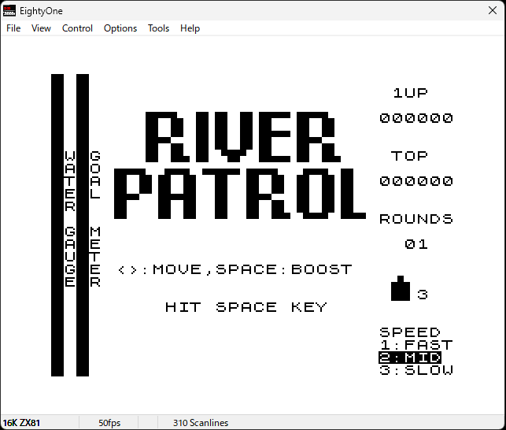
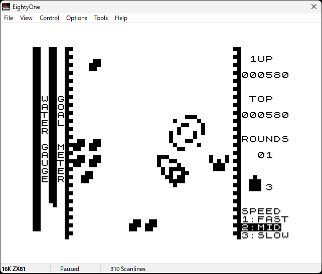

# RiverPatrol - ZX81 Arcade Port

River Patrol の ZX81 移植版です。

アーケード版を参考に全10ラウンドを実装しました。

## 特徴

- 1ピクセル単位でのスクロールと移動ルーチン
- 描画と衝突判定のための Z80 アセンブリルーチン
- 10ラウンド（アーケード版の全16ラウンドを、ZX81の16KBメモリ制約に合わせて10ラウンドに再構成）
- ゲーム速度の選択（FAST / MID / SLOW）
- z88dk を使って C 言語で開発（部分的に速度向上が必要な箇所は Z80 アセンブリで記述）

## コンパイル方法

### z88dk

z88dk を使用しています。

ダウンロード：

https://github.com/z88dk/z88dk/releases#release-v1.99c

開発環境：

- z88dk v13913-9abd768-20190119
- Custom Z80 assembly routines

展開した z88dk を任意のフォルダへコピーします。

例：

```text
D:\tmp\z88dk
```

### コマンドプロンプト

環境変数を設定します。

```bat
PATH=%PATH%;D:\tmp\z88dk\bin
set ZCCCFG=D:\tmp\z88dk\lib\config
```

※ `D:\tmp\z88dk` は実際の配置先に変更してください。

毎回入力するのが面倒な場合は、バッチファイルにしておくと便利です。

### コンパイル

以下のコマンドを実行します。

```bat
zcc +zx81 -create-app main.c map.c key.c scrn.c boat.c objects.c mapdata.c
```

コンパイルが成功すると `a.P` が生成されます。

## ZX81エミュレータで実行

ZX81 エミュレータを起動し、

```text
File → Open Tape...
```

から `a.P` を読み込んで実行してください。

## 操作方法

タイトル画面で速度を選択し、ゲームを開始します。

| キー | 内容 |
| ------ | ------ |
| ← → | 自船移動 |
| SPACE | スタート / BOOST |
| 1 | FAST |
| 2 | MID |
| 3 | SLOW |
| ENTER | 強制終了 |

## スクリーンショット

### タイトル画面



### プレイ画面



## 開発記録

開発の詳細は以下のブログで紹介しています。

https://plaza.rakuten.co.jp/zx81fun/

## 動画

RiverPatrol Final - ZX81 Arcade Port

YouTube:
https://www.youtube.com/watch?v=soLcWBnBMcc

## Author

ZX81-program